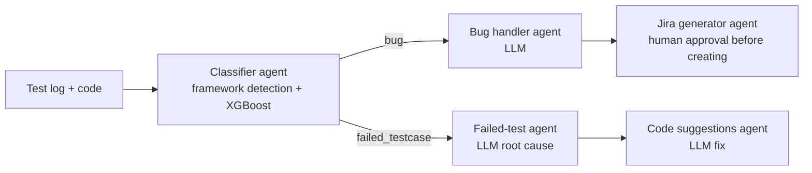
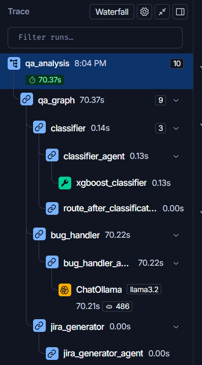

# QA Assistant — Agentic Test-Failure Triage


When an automated test fails, someone has to decide: **is the application broken, or is the test broken?**
QA Assistant answers that from the test's log and code, then drafts a **Jira bug ticket** (with human approval) or **suggests a fix** for the test.

**Demo:** [live link — planned] · [60–90 s video] · [paper DOI, once corrected]

[screenshot: Analyze page] [screenshot: result + Jira approval]

---

## How it works



| Agent | What it does |
|---|---|
| Classifier | Detects the framework (Selenium, Playwright, pytest, API, DB), then classifies with XGBoost on 52 engineered features (LLM fallback if no model) |
| Bug handler | Writes the bug analysis: summary, steps, expected vs actual, suggested fix |
| Jira generator | Prepares the ticket; a human approves priority/severity before it is created |
| Failed-test handler | Finds the root cause in the test (locator, wait, test data, environment) |
| Code suggestions | Produces corrected test code and best practices |

**Stack:** LangGraph · LangChain · XGBoost · FastAPI · SQLAlchemy/SQLite · React (Vite, Tailwind) · Jira REST API · LangSmith · Docker · GitHub Actions
**LLMs:** Llama 3.2 via Ollama (local) · Groq (hosted), selected with `LLM_PROVIDER`

---

## Evaluation

### Dataset v1 (212 labeled failures)
| Source | Cases | Labeling |
|---|---:|---|
| Synthetic fault injection (`inject.py`) | 150 | Known by construction — 30 fault templates (wrong locator, missing wait, API 500, DB down, off-by-one, …) |
| Real GitHub CI failures (`mine_github.py`) | 32 | By fix location: fix changed app code → bug, only tests → failed_testcase; each reviewed by hand |
| Legacy hand-written cases | 30 | Used while writing prompts → dev only |

5 frameworks × 2 labels, ≥30 cases per framework. **Frozen split:** 155 dev / 57 test.
Synthetic cases are split by **whole template**, so test contains failure patterns never seen in dev (prevents memorizing near-duplicates).
All tuning (e.g. the hybrid threshold) is done on dev only.

### Classification — held-out test split (n = 57)
| Pipeline | Accuracy (95% CI) | Macro-F1 (95% CI) | Bug P / R | Failed-test P / R | p50 latency |
|---|---|---|---|---|---|
| XGBoost | 63.2% (49.1–75.4) | 0.632 (0.491–0.752) | 0.64 / 0.62 | 0.62 / 0.64 | < 10 ms |
| LLM (Llama 3.2, 3B) | 66.7% (54.4–78.9) | 0.645 (0.505–0.763) | 0.86 / 0.41 | 0.60 / 0.93 | 6.0 s |
| Hybrid (XGBoost; LLM when confidence < 0.7) | 63.2% (50.9–75.4) | 0.632 (0.501–0.751) | 0.64 / 0.62 | 0.62 / 0.64 | < 10 ms |

CIs: 1,000 bootstrap resamples. Paired comparison (exact McNemar): XGBoost vs LLM 8 vs 10 discordant cases, **p = 0.815** — no pipeline is significantly better.

[confusion matrix images: evaluation/results/<final run>/confusion_xgboost.png, confusion_llm.png]

**Findings**
1. **XGBoost is confidently wrong on unseen failure types.** On the two held-out templates "Selenium missing wait" and "Playwright missing await", it got 0/10 right with confidence ≥ 0.7, so the confidence-gated hybrid never asked the LLM (which got 9/10 of them). Confidence from a model trained on hand-written patterns is not a reliable signal for novel failures → next step: calibration.
2. **The LLM under-calls bugs:** bug recall 0.41 vs failed-test recall 0.93 — it tends to blame the test.
3. **XGBoost dropped from 0.726 macro-F1 on dev to 0.632 on test**, the cost of testing on unseen templates.
4. Hybrid threshold chosen on dev (0.6–0.9 all within 0.02 macro-F1, 0.7 best) — results are insensitive to it.

### Generated text — Jira drafts and fix suggestions
30 test cases (15 bug, 15 failed); generator `openai/gpt-oss-20b` (Groq), judge `qwen/qwen3.8-27b` (different model family, to avoid self-preference).
Rubric 1–5: correctness (right cause vs known reference), groundedness (factual claims supported by log/code), actionability.

| Output | Correctness | Groundedness | Actionability | Outputs with ≥1 invented fact (judge / rule check) |
|---|---:|---:|---:|---:|
| Jira drafts | 5.00 | 4.60 | 4.87 | 20% / 20% |
| Fix suggestions | 5.00 | 5.00 | 5.00 | 0% / 0% |

- **Rule-based hallucination check** (`grounding.py`): flags exception names, status codes, quoted names and file paths in the output's claims that don't appear in the input.
- **Rubric v1 → v2:** the first judge (gpt-oss-120b) flagged 100% of outputs because it counted proposed fixes as hallucinations; v2 excludes recommendations and hedged hypotheses.
- **Not yet validated against human labels** (Cohen's κ planned). Scores near 5 also reflect that the agent is told the correct branch.

### Observability (LangSmith)
Each of the 5 agents is a traced run tagged `agent:<name>`, with metadata (run_id, framework, classification, model). `/api/analyze` returns `trace_run_id`.



| Agent | Runs | p50 latency | p95 latency | Avg prompt tokens | Avg completion tokens | Actual cost / run | Est. cost on openai/gpt-oss-20b / run |
|---|---:|---:|---:|---:|---:|---:|---:|
| bug_handler | 1 | 70.22 s | 70.22 s | 290 | 196 | $0.000000 | $0.000081 |
| classifier | 3 | 0.42 s | 5.30 s | 0 | 0 | $0.000000 | $0.000000 |
| code_suggestions | 2 | 112.63 s | 136.85 s | 314 | 237 | $0.000000 | $0.000095 |
| failed_testcase_handler | 2 | 82.34 s | 123.16 s | 375 | 86 | $0.000000 | $0.000054 |
| jira_generator | 1 | 0.00 s | 0.00 s | 0 | 0 | $0.000000 | $0.000000 |

### CI
Every push/PR runs `pytest` and a **regression gate**: XGBoost macro-F1 on the frozen test split must not drop more than 3 points below `evaluation/baseline.json` (and the test split itself must not change). The gate uses XGBoost only — no LLM or API keys in CI.

---

## Run it locally

```bash
git clone https://github.com/Vaish0202/qa-assistant.git
cd qa-assistant
python -m venv venv && venv\Scripts\activate      # Windows
pip install -r requirements.txt
cp .env.example .env                               # fill in keys
ollama pull llama3.2                               # for LLM_PROVIDER=ollama
uvicorn main:app --reload                          # API docs: http://localhost:8000/docs
cd frontend && npm install && npm run dev
```

| Variable | Purpose |
|---|---|
| `LLM_PROVIDER` | `ollama` (local) or `groq` |
| `GROQ_API_KEY`, `GROQ_MODEL` | Hosted LLM (run `python scripts/list_groq_models.py`) |
| `JUDGE_PROVIDER`, `JUDGE_MODEL` | LLM-as-judge model |
| `LANGSMITH_TRACING`, `LANGSMITH_API_KEY`, `LANGSMITH_PROJECT` | Tracing |
| `JIRA_URL`, `JIRA_EMAIL`, `JIRA_API_TOKEN`, `JIRA_PROJECT_KEY` | Jira integration |

## Reproduce the evaluation

```bash
# dataset
python -m evaluation.datasets.convert_existing
python -m evaluation.datasets.inject --per-stratum 15 --dataset v1
python -m evaluation.datasets.mine_github --merge          # after reviewing candidates
python -m evaluation.datasets.split --dataset v1
python -m evaluation.datasets.validate --dataset v1

# classification
python -m evaluation.run --dataset v1 --split dev  --pipeline hybrid --threshold 0.7
python -m evaluation.run --dataset v1 --split test --pipeline all    --threshold 0.7

# generated text
python -m evaluation.generation.generate --n 30
python -m evaluation.generation.judge

# tests + CI gate
python -m pytest tests -q
python -m evaluation.ci_gate
```

## Deployment
[Planned: FastAPI backend on Railway (Docker), React frontend on Vercel, Groq as the hosted LLM. Update once live.]

## Limitations
- Small test set (n = 57) → wide confidence intervals; per-framework groups (10–13 cases) are indicative only.
- Mostly synthetic data; only 32 real cases (7 in test), 31 of them log-only (no test code).
- Labels by a single annotator; GitHub labels inferred from fix location.
- LLM judge not yet validated against human scores.
- XGBoost features were designed by the same author who wrote the synthetic templates.

## Roadmap
- Calibrate XGBoost confidence (ECE, temperature/Platt scaling) so the hybrid routes correctly
- Human validation of the judge (Cohen's κ)
- More real failures; evaluate on all 32 real cases as a separate slice
- AWS Bedrock as an LLM provider; fine-tuned transformer classifier on SageMaker

## Papers
QA Assistant: An Agentic AI System for Intelligent Test Failure Classification and Automated Bug Diagnosis: https://doi.org/10.5281/zenodo.22793445
When to Use ML, LLM, or Hybrid Approaches for Software Test Failure Classification:A Framework-Aware Comparative Study: https://doi.org/10.5281/zenodo.22902516