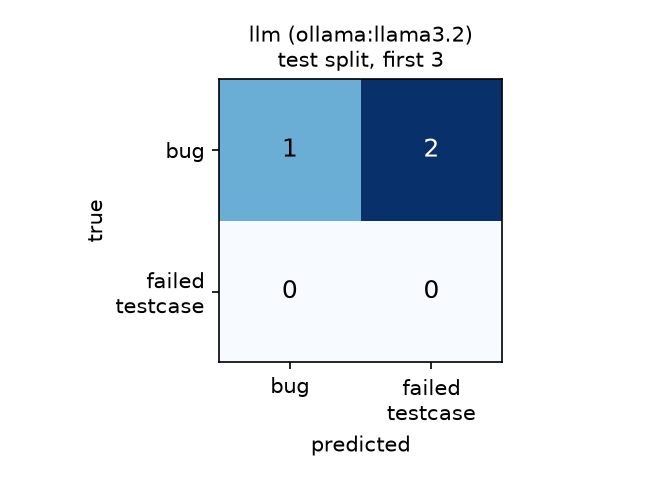

# Evaluation: v1 / test split, first 3 (n=3)

Cases by source: {'synthetic': 3}  ·  by label: {'bug': 3}

| Pipeline | Accuracy (95% CI) | Macro-F1 (95% CI) | Bug P / R | Failed-TC P / R | p50 time | LLM calls |
|---|---|---|---|---|---:|---:|
| llm (ollama:llama3.2) | 33.3% (0.0%–100.0%) | 0.250 (0.000–1.000) | 1.00 / 0.33 | 0.00 / 0.00 | 22.37 s | 3 |

## llm (ollama:llama3.2)

| By framework | n | Accuracy | Macro-F1 |
|---|---:|---:|---:|
| api | 3 | 33.3% | 0.250 |

| By source | n | Accuracy | Macro-F1 |
|---|---:|---:|---:|
| synthetic | 3 | 33.3% | 0.250 |

Notes: unreadable LLM answers count as wrong. Macro-F1 averages only the classes present in the sample. 95% CIs from 1,000 bootstrap resamples. Groups with small n are indicative only.
