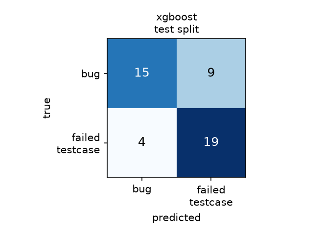
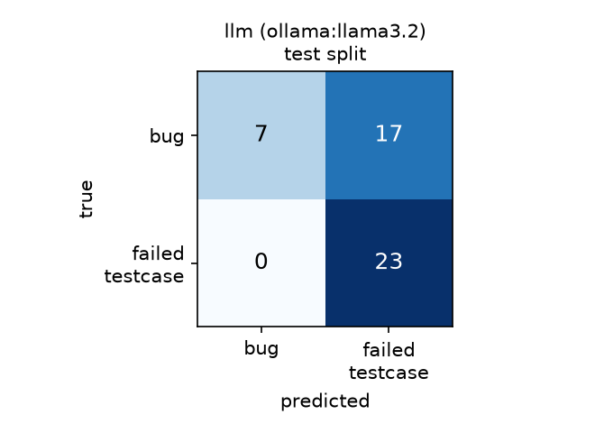
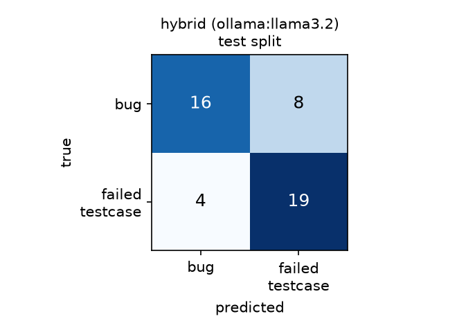

# Evaluation: v1 / test split (n=47)

Cases by source: {'synthetic': 40, 'github': 7}  ·  by label: {'bug': 24, 'failed_testcase': 23}

| Pipeline | Accuracy (95% CI) | Macro-F1 (95% CI) | Bug P / R | Failed-TC P / R | p50 time | LLM calls |
|---|---|---|---|---|---:|---:|
| xgboost | 72.3% (57.4%–85.1%) | 0.721 (0.573–0.850) | 0.79 / 0.62 | 0.68 / 0.83 | 0.00 s | 0 |
| llm (ollama:llama3.2) | 63.8% (51.0%–76.6%) | 0.591 (0.431–0.735) | 1.00 / 0.29 | 0.57 / 1.00 | 11.20 s | 44 |
| hybrid (ollama:llama3.2) | 74.5% (61.6%–85.1%) | 0.744 (0.595–0.851) | 0.80 / 0.67 | 0.70 / 0.83 | 0.01 s | 0 |

## xgboost

| By framework | n | Accuracy | Macro-F1 |
|---|---:|---:|---:|
| api | 10 | 60.0% | 0.583 |
| db | 9 | 100.0% | 1.000 |
| playwright | 11 | 63.6% | 0.633 |
| selenium | 8 | 100.0% | 1.000 |
| unit | 9 | 44.4% | 0.308 |

| By source | n | Accuracy | Macro-F1 |
|---|---:|---:|---:|
| github | 7 | 85.7% | 0.857 |
| synthetic | 40 | 70.0% | 0.697 |

## llm (ollama:llama3.2)

| By framework | n | Accuracy | Macro-F1 |
|---|---:|---:|---:|
| api | 10 | 60.0% | 0.583 |
| db | 9 | 77.8% | 0.775 |
| playwright | 11 | 63.6% | 0.389 |
| selenium | 8 | 50.0% | 0.333 |
| unit | 9 | 66.7% | 0.649 |

| By source | n | Accuracy | Macro-F1 |
|---|---:|---:|---:|
| github | 7 | 57.1% | 0.533 |
| synthetic | 40 | 65.0% | 0.601 |

## hybrid (ollama:llama3.2)

| By framework | n | Accuracy | Macro-F1 |
|---|---:|---:|---:|
| api | 10 | 60.0% | 0.583 |
| db | 9 | 88.9% | 0.889 |
| playwright | 11 | 63.6% | 0.633 |
| selenium | 8 | 100.0% | 1.000 |
| unit | 9 | 66.7% | 0.649 |

| By source | n | Accuracy | Macro-F1 |
|---|---:|---:|---:|
| github | 7 | 57.1% | 0.533 |
| synthetic | 40 | 77.5% | 0.775 |

## Paired comparison (McNemar, exact)

| A vs B | only A right | only B right | p-value |
|---|---:|---:|---:|
| xgboost vs llm (ollama:llama3.2) | 11 | 7 | 0.481 |
| xgboost vs hybrid (ollama:llama3.2) | 2 | 3 | 1.000 |
| llm (ollama:llama3.2) vs hybrid (ollama:llama3.2) | 4 | 9 | 0.267 |

Notes: unreadable LLM answers count as wrong. Macro-F1 averages only the classes present in the sample. 95% CIs from 1,000 bootstrap resamples. Groups with small n are indicative only.
