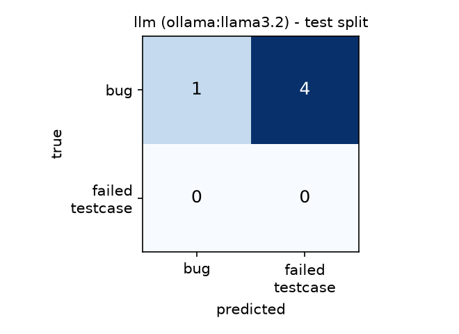

# Evaluation: v1 / test split (n=5)

Cases by source: {'synthetic': 5} · by label: {'bug': 5}

| Pipeline | Accuracy (95% CI) | Macro-F1 (95% CI) | Bug P / R / F1 | Failed-TC P / R / F1 | p50 time | Unparsed |
|---|---|---|---|---|---:|---:|
| llm (ollama:llama3.2) | 20.0% (0.0%–60.0%) | 0.167 (0.000–0.375) | 1.00 / 0.20 / 0.33 | 0.00 / 0.00 / 0.00 | 22.37 s | 0 |

## llm (ollama:llama3.2)

| true \ predicted | bug | failed_testcase | unparsed |
|---|---:|---:|---:|
| bug | 1 | 4 | 0 |
| failed_testcase | 0 | 0 | 0 |

| By framework | n | Accuracy | Macro-F1 |
|---|---:|---:|---:|
| api | 5 | 20.0% | 0.167 |

| By source | n | Accuracy | Macro-F1 |
|---|---:|---:|---:|
| synthetic | 5 | 20.0% | 0.167 |

Unparsed LLM answers count as wrong. 95% CIs from 1,000 bootstrap resamples. Groups with small n are indicative only.
