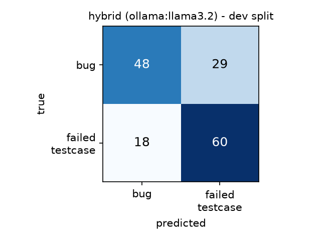

# Evaluation: v1 / dev split (n=155)

Cases by source: {'legacy_sample': 30, 'synthetic': 100, 'github': 25} · by label: {'failed_testcase': 78, 'bug': 77}

| Pipeline | Accuracy (95% CI) | Macro-F1 (95% CI) | Bug P / R / F1 | Failed-TC P / R / F1 | p50 time | Unparsed |
|---|---|---|---|---|---:|---:|
| hybrid (ollama:llama3.2) | 69.7% (62.6%–76.8%) | 0.695 (0.619–0.766) | 0.73 / 0.62 / 0.67 | 0.67 / 0.77 / 0.72 | 0.01 s | 0 |

## hybrid (ollama:llama3.2)

| true \ predicted | bug | failed_testcase | unparsed |
|---|---:|---:|---:|
| bug | 48 | 29 | 0 |
| failed_testcase | 18 | 60 | 0 |

| By framework | n | Accuracy | Macro-F1 |
|---|---:|---:|---:|
| api | 30 | 40.0% | 0.389 |
| db | 26 | 69.2% | 0.660 |
| playwright | 32 | 96.9% | 0.965 |
| selenium | 30 | 83.3% | 0.824 |
| unit | 37 | 59.5% | 0.584 |

| By source | n | Accuracy | Macro-F1 |
|---|---:|---:|---:|
| github | 25 | 60.0% | 0.540 |
| legacy_sample | 30 | 80.0% | 0.792 |
| synthetic | 100 | 69.0% | 0.687 |

LLM answered 16 of 155 cases (XGBoost confidence below 0.6).

Unparsed LLM answers count as wrong. 95% CIs from 1,000 bootstrap resamples. Groups with small n are indicative only.
