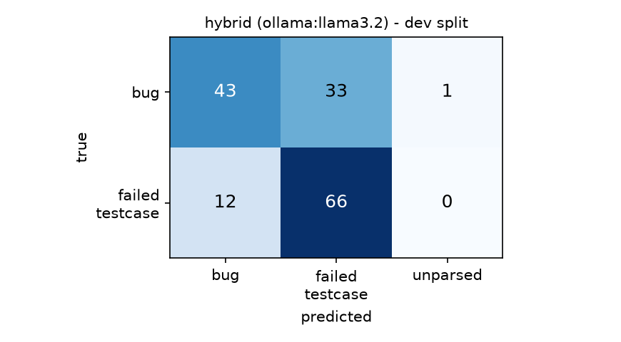

# Evaluation: v1 / dev split (n=155)

Cases by source: {'legacy_sample': 30, 'synthetic': 100, 'github': 25} · by label: {'failed_testcase': 78, 'bug': 77}

| Pipeline | Accuracy (95% CI) | Macro-F1 (95% CI) | Bug P / R / F1 | Failed-TC P / R / F1 | p50 time | Unparsed |
|---|---|---|---|---|---:|---:|
| hybrid (ollama:llama3.2) | 70.3% (62.6%–77.4%) | 0.699 (0.620–0.771) | 0.78 / 0.56 / 0.65 | 0.67 / 0.85 / 0.75 | 5.77 s | 1 |

## hybrid (ollama:llama3.2)

| true \ predicted | bug | failed_testcase | unparsed |
|---|---:|---:|---:|
| bug | 43 | 33 | 1 |
| failed_testcase | 12 | 66 | 0 |

| By framework | n | Accuracy | Macro-F1 |
|---|---:|---:|---:|
| api | 30 | 53.3% | 0.525 |
| db | 26 | 73.1% | 0.710 |
| playwright | 32 | 81.2% | 0.750 |
| selenium | 30 | 96.7% | 0.981 |
| unit | 37 | 51.4% | 0.418 |

| By source | n | Accuracy | Macro-F1 |
|---|---:|---:|---:|
| github | 25 | 72.0% | 0.688 |
| legacy_sample | 30 | 70.0% | 0.693 |
| synthetic | 100 | 70.0% | 0.698 |

LLM answered 83 of 155 cases (XGBoost confidence below 0.9).

Unparsed LLM answers count as wrong. 95% CIs from 1,000 bootstrap resamples. Groups with small n are indicative only.
