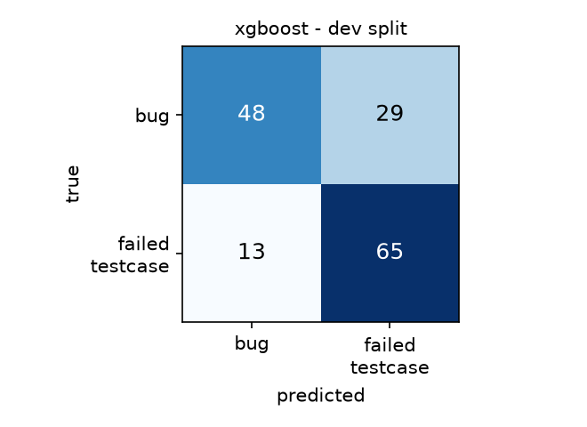

# Evaluation: v1 / dev split (n=155)

Cases by source: {'legacy_sample': 30, 'synthetic': 100, 'github': 25} · by label: {'failed_testcase': 78, 'bug': 77}

| Pipeline | Accuracy (95% CI) | Macro-F1 (95% CI) | Bug P / R / F1 | Failed-TC P / R / F1 | p50 time | Unparsed |
|---|---|---|---|---|---:|---:|
| xgboost | 72.9% (65.8%–80.0%) | 0.726 (0.654–0.794) | 0.79 / 0.62 / 0.70 | 0.69 / 0.83 / 0.76 | 0.00 s | 0 |

## xgboost

| true \ predicted | bug | failed_testcase | unparsed |
|---|---:|---:|---:|
| bug | 48 | 29 | 0 |
| failed_testcase | 13 | 65 | 0 |

| By framework | n | Accuracy | Macro-F1 |
|---|---:|---:|---:|
| api | 30 | 60.0% | 0.598 |
| db | 26 | 69.2% | 0.660 |
| playwright | 32 | 96.9% | 0.965 |
| selenium | 30 | 80.0% | 0.792 |
| unit | 37 | 59.5% | 0.584 |

| By source | n | Accuracy | Macro-F1 |
|---|---:|---:|---:|
| github | 25 | 60.0% | 0.540 |
| legacy_sample | 30 | 76.7% | 0.753 |
| synthetic | 100 | 75.0% | 0.744 |

Unparsed LLM answers count as wrong. 95% CIs from 1,000 bootstrap resamples. Groups with small n are indicative only.
