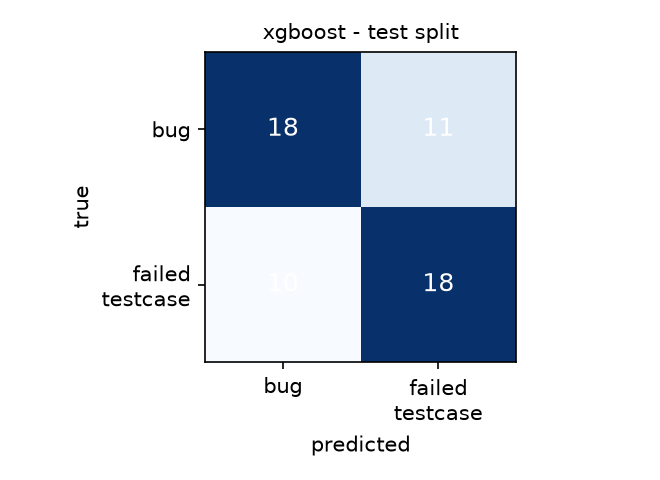
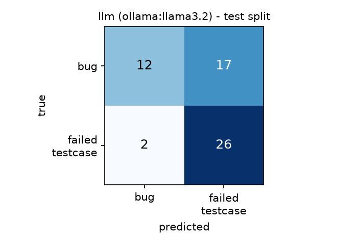
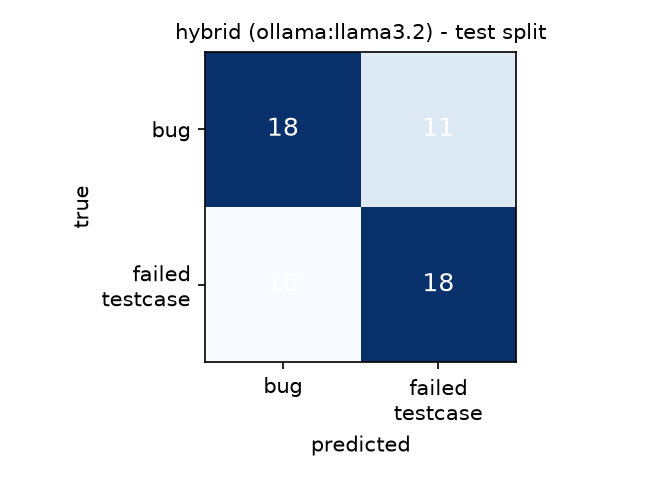

# Evaluation: v1 / test split (n=57)

Cases by source: {'synthetic': 50, 'github': 7} · by label: {'bug': 29, 'failed_testcase': 28}

| Pipeline | Accuracy (95% CI) | Macro-F1 (95% CI) | Bug P / R / F1 | Failed-TC P / R / F1 | p50 time | Unparsed |
|---|---|---|---|---|---:|---:|
| xgboost | 63.2% (49.1%–75.4%) | 0.632 (0.491–0.752) | 0.64 / 0.62 / 0.63 | 0.62 / 0.64 / 0.63 | 0.00 s | 0 |
| llm (ollama:llama3.2) | 66.7% (54.4%–78.9%) | 0.645 (0.505–0.763) | 0.86 / 0.41 / 0.56 | 0.60 / 0.93 / 0.73 | 6.01 s | 0 |
| hybrid (ollama:llama3.2) | 63.2% (50.9%–75.4%) | 0.632 (0.501–0.751) | 0.64 / 0.62 / 0.63 | 0.62 / 0.64 / 0.63 | 0.01 s | 0 |

## xgboost

| true \ predicted | bug | failed_testcase | unparsed |
|---|---:|---:|---:|
| bug | 18 | 11 | 0 |
| failed_testcase | 10 | 18 | 0 |

| By framework | n | Accuracy | Macro-F1 |
|---|---:|---:|---:|
| api | 12 | 58.3% | 0.556 |
| db | 11 | 100.0% | 1.000 |
| playwright | 13 | 61.5% | 0.606 |
| selenium | 10 | 50.0% | 0.333 |
| unit | 11 | 45.5% | 0.312 |

| By source | n | Accuracy | Macro-F1 |
|---|---:|---:|---:|
| github | 7 | 85.7% | 0.857 |
| synthetic | 50 | 60.0% | 0.600 |

## llm (ollama:llama3.2)

| true \ predicted | bug | failed_testcase | unparsed |
|---|---:|---:|---:|
| bug | 12 | 17 | 0 |
| failed_testcase | 2 | 26 | 0 |

| By framework | n | Accuracy | Macro-F1 |
|---|---:|---:|---:|
| api | 12 | 58.3% | 0.556 |
| db | 11 | 81.8% | 0.817 |
| playwright | 13 | 61.5% | 0.381 |
| selenium | 10 | 80.0% | 0.792 |
| unit | 11 | 54.5% | 0.476 |

| By source | n | Accuracy | Macro-F1 |
|---|---:|---:|---:|
| github | 7 | 57.1% | 0.533 |
| synthetic | 50 | 68.0% | 0.660 |

## hybrid (ollama:llama3.2)

| true \ predicted | bug | failed_testcase | unparsed |
|---|---:|---:|---:|
| bug | 18 | 11 | 0 |
| failed_testcase | 10 | 18 | 0 |

| By framework | n | Accuracy | Macro-F1 |
|---|---:|---:|---:|
| api | 12 | 58.3% | 0.556 |
| db | 11 | 90.9% | 0.909 |
| playwright | 13 | 61.5% | 0.606 |
| selenium | 10 | 50.0% | 0.333 |
| unit | 11 | 54.5% | 0.476 |

| By source | n | Accuracy | Macro-F1 |
|---|---:|---:|---:|
| github | 7 | 57.1% | 0.533 |
| synthetic | 50 | 64.0% | 0.639 |

LLM answered 28 of 57 cases (XGBoost confidence below 0.7).

## Paired comparison (exact McNemar)

| A vs B | only A right | only B right | p-value |
|---|---:|---:|---:|
| xgboost vs llm (ollama:llama3.2) | 8 | 10 | 0.815 |
| xgboost vs hybrid (ollama:llama3.2) | 2 | 2 | 1.000 |
| llm (ollama:llama3.2) vs hybrid (ollama:llama3.2) | 8 | 6 | 0.791 |

Unparsed LLM answers count as wrong. 95% CIs from 1,000 bootstrap resamples. Groups with small n are indicative only.
